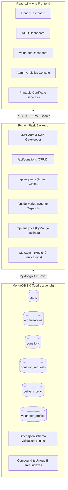

# FoodRescue: Intelligent Food Waste Rescue & Redistribution System
## Course: CSE494 – Intelligent NoSQL Databases | Academic Project Report

---

### Table of Contents
1. [Abstract](#1-abstract)
2. [Problem Statement](#2-problem-statement)
3. [Objectives](#3-objectives)
4. [System Architecture](#4-system-architecture)
5. [Technology Stack](#5-technology-stack)
6. [MongoDB Document Design & Modeling](#6-mongodb-document-design--modeling)
7. [Referencing vs. Embedding Architectural Decisions](#7-referencing-vs-embedding-architectural-decisions)
8. [Collection Schemas & $jsonSchema Strict Validation](#8-collection-schemas--jsonschema-strict-validation)
9. [Index Strategy & Query Optimization](#9-index-strategy--query-optimization)
10. [CRUD Operations & Output Samples](#10-crud-operations--output-samples)
11. [MongoDB Aggregation Pipelines & Outputs](#11-mongodb-aggregation-pipelines--outputs)
12. [Python–MongoDB PyMongo Integration & Concurrency Safety](#12-pythonmongodb-pymongo-integration--concurrency-safety)
13. [Role-Based Access & Security](#13-role-based-access--security)
14. [Automated Test Suite & Verification Results](#14-automated-test-suite--verification-results)
15. [User Interface & Visual Workflow](#15-user-interface--visual-workflow)
16. [Results & Academic Conclusion](#16-results--academic-conclusion)

---

### 1. Abstract
Urban food waste and community food insecurity exist concurrently in modern metropolitan environments. While commercial dining halls, corporate cafeterias, and bakeries generate surplus edible food daily, local shelters and community kitchens frequently face acute food supply deficits. **FoodRescue** is an end-to-end, full-stack intelligent NoSQL web application designed to bridge this divide. Built upon MongoDB 8.0, Python (Flask), and React (Vite & Tailwind CSS), FoodRescue implements database-level `$jsonSchema` validation, high-efficiency B-tree indexes, atomic concurrency-safe state transitions, and six multi-stage PyMongo aggregation pipelines to provide real-time tracking of rescued surplus food, certified volunteer courier logistics, and transparent receipt verification.

---

### 2. Problem Statement
Commercial food service providers discard tons of safe, edible food due to strict daily shelf-life policies and a lack of real-time coordination with charitable shelters. Key operational challenges include:
- **Food Safety & Shelf-Life Deadlines**: Surplus food has short freshness windows and strict storage criteria.
- **Coordination Lag & Concurrency Clashes**: Without atomic reservations, multiple NGOs might simultaneously claim the same surplus lot or multiple volunteers might accept the same transport run.
- **Traceability Deficits**: Lack of verifiable delivery confirmation leads to uncollected donations, duplicate reward distributions, and inaccurate impact metrics.

---

### 3. Objectives
1. **Intelligent Document Modeling**: Model domain entities (`users`, `organizations`, `donations`, `donation_requests`, `delivery_tasks`, `volunteer_profiles`) adhering to MongoDB document modeling standards.
2. **Database-Level Data Integrity**: Implement strict MongoDB `$jsonSchema` collection validators to prevent malformed records (e.g. non-positive food weights, invalid status enums).
3. **Concurrency-Safe Workflows**: Leverage atomic operations (`find_one_and_update`) to prevent race conditions in donation claiming and courier assignment.
4. **Multi-Stage Aggregation Pipelines**: Implement at least six aggregation pipelines in Python PyMongo computing live KPIs, historical trends, donor contributions, courier rankings, and fulfillment statistics.
5. **Role-Based Portals**: Provide customized interfaces for Food Donors, NGOs/Shelters, Volunteer Couriers, and System Administrators.
6. **Verified Reward & Certification Engine**: Award volunteer points and printable certificates strictly upon confirmed recipient receipt.

---

### 4. System Architecture



---

### 5. Technology Stack

| Layer | Component | Version / Library | Purpose |
| :--- | :--- | :--- | :--- |
| **Frontend** | React | 18.3.1 | Component-based reactive user interface |
| **Tooling** | Vite | 5.4.10 | High-performance build tool and dev server |
| **Styling** | Tailwind CSS | 3.4.14 | Modern responsive utility-first design |
| **Visualizations**| Recharts | 2.13.0 | Real-time analytical SVG charts for aggregation data |
| **Icons** | Lucide React | 0.454.0 | Accessible semantic UI icons |
| **Backend** | Python Flask | 3.1.3 | Modular REST API organized with Blueprints |
| **Database Driver**| PyMongo | 4.19.0 | Official Python driver for MongoDB integration |
| **Security** | PyJWT & Werkzeug | 2.15.1 / 3.1.9 | JWT bearer tokens & scrypt/pbkdf2 password hashing |
| **Database** | MongoDB Community | 8.0 | Document-oriented NoSQL database |
| **Testing** | Pytest | 9.1.1 | Automated testing framework for APIs & schema validation |

---

### 6. MongoDB Document Design & Modeling

Database Name: `foodrescue_db`

#### Collection 1: `users`
Represents platform actors across all 4 roles.
```json
{
  "_id": {"$oid": "67b8a1c8eade8b15ce82df54"},
  "name": "Annapurna Grand Restaurant",
  "email": "donor1@annapurna.in",
  "passwordHash": "pbkdf2:sha256:...",
  "role": "donor",
  "phone": "+91-98490-12345",
  "address": "45, MG Road, Indiranagar, Bengaluru",
  "createdAt": {"$date": "2026-09-07T13:22:00Z"},
  "isActive": true
}
```

#### Collection 2: `organizations`
Profiles registered NGOs, shelters, and community kitchens.
```json
{
  "_id": {"$oid": "67b8a1c8eade8b15ce82df57"},
  "userId": {"$oid": "67b8a1c8eade8b15ce82df55"},
  "organizationName": "Roti Bank Seva Trust",
  "organizationType": "Community Kitchen & Food Pantry",
  "serviceArea": "Indiranagar & East Bengaluru",
  "verificationStatus": "verified",
  "createdAt": {"$date": "2026-09-12T13:22:00Z"}
}
```

#### Collection 3: `donations`
Surplus food lots created by commercial dining kitchens.
```json
{
  "_id": {"$oid": "67b8a1c8eade8b15ce82df60"},
  "donorId": {"$oid": "67b8a1c8eade8b15ce82df54"},
  "foodName": "Hyderabadi Vegetable Dum Biryani & Mirchi Ka Salan",
  "category": "Cooked Meals",
  "quantityKg": 25.0,
  "preparedAt": {"$date": "2026-10-10T10:15:00Z"},
  "availableUntil": {"$date": "2026-10-10T18:00:00Z"},
  "pickupAddress": "45, MG Road, Indiranagar, Bengaluru",
  "dietaryInfo": ["Pure Vegetarian", "Halal Certified"],
  "description": "50 large foil containers of fragrant vegetable basmati biryani with spicy salan.",
  "status": "delivered",
  "createdAt": {"$date": "2026-10-10T09:00:00Z"},
  "updatedAt": {"$date": "2026-10-10T14:30:00Z"}
}
```

#### Collection 4: `donation_requests`
Formal claims submitted by verified shelters.
```json
{
  "_id": {"$oid": "67b8a1c8eade8b15ce82df65"},
  "donationId": {"$oid": "67b8a1c8eade8b15ce82df60"},
  "organizationId": {"$oid": "67b8a1c8eade8b15ce82df57"},
  "requestedQuantityKg": 25.0,
  "status": "fulfilled",
  "requestedAt": {"$date": "2026-10-10T09:25:00Z"},
  "reviewedAt": {"$date": "2026-10-10T09:45:00Z"}
}
```

#### Collection 5: `delivery_tasks`
Couriers’ delivery assignment and proof-of-delivery record.
```json
{
  "_id": {"$oid": "67b8a1c8eade8b15ce82df70"},
  "donationId": {"$oid": "67b8a1c8eade8b15ce82df60"},
  "requestId": {"$oid": "67b8a1c8eade8b15ce82df65"},
  "volunteerId": {"$oid": "67b8a1c8eade8b15ce82df58"},
  "status": "delivered",
  "pickedUpAt": {"$date": "2026-10-10T10:30:00Z"},
  "deliveredAt": {"$date": "2026-10-10T11:45:00Z"},
  "foodQuantityKg": 25.0,
  "pointsAwarded": true,
  "createdAt": {"$date": "2026-10-10T09:50:00Z"}
}
```

#### Collection 6: `volunteer_profiles`
Gamified courier telemetry, vehicle capacity, and badge milestones.
```json
{
  "_id": {"$oid": "67b8a1c8eade8b15ce82df75"},
  "userId": {"$oid": "67b8a1c8eade8b15ce82df58"},
  "serviceArea": "Indiranagar & Koramangala, Bengaluru",
  "availability": "available",
  "transportType": "car",
  "transportCapacityKg": 50.0,
  "totalDeliveries": 8,
  "totalFoodDeliveredKg": 165.0,
  "totalPoints": 240,
  "badges": ["First Rescue", "Hunger Hero", "Super Courier", "Century Rescuer"],
  "createdAt": {"$date": "2026-09-17T13:22:00Z"}
}
```

---

### 7. Referencing vs. Embedding Architectural Decisions

A central requirement of NoSQL database modeling is choosing between **Normalized Referencing** (using `ObjectId` pointers) and **Denormalized Embedding** (nesting sub-documents).

#### Why Referencing is Used for Core Entities:
1. **High Concurrency & Independent Mutation**:
   - `donations`, `donation_requests`, and `delivery_tasks` transition through their lifecycles independently.
   - If requests were embedded inside donations, concurrent requests from multiple NGOs would create write contention and require complex document locking on the single donation parent.
2. **Preventing Unbounded Document Growth**:
   - A single volunteer courier completes dozens of rescue deliveries over time. Embedding all completed delivery logs inside `volunteer_profiles` would risk violating the **MongoDB 16MB document size limit** and degrade B-tree index efficiency.
3. **Multi-directional Querying**:
   - Deliveries must be queried from three orthogonal perspectives: By Volunteer (`delivery_tasks.find({"volunteerId": volId})`), by NGO (`delivery_tasks.find({"requestId": reqId})`), and by Donor (`delivery_tasks.find({"donationId": donId})`). Normalized references make this indexing natural and fast.

#### Where Embedding is Applied:
1. **`dietaryInfo` inside `donations`**:
   - Tags like `["Vegetarian", "Gluten-Free", "Halal"]` are bounded, read together with the donation listing, and do not mutate after food listing creation.
2. **`badges` inside `volunteer_profiles`**:
   - Achievement strings are low cardinality (< 10 total badges), tightly coupled to the volunteer profile, and read whenever profile telemetry is loaded.

---

### 8. Collection Schemas & $jsonSchema Strict Validation
MongoDB enforces strict document schemas using `$jsonSchema`. Configured via `db.create_collection(..., validator=schema, validationLevel="strict", validationAction="error")`.

#### Validation Snapshot: `donations` Collection
```python
DONATIONS_SCHEMA = {
    "$jsonSchema": {
        "bsonType": "object",
        "required": [
            "donorId", "foodName", "category", "quantityKg",
            "preparedAt", "availableUntil", "pickupAddress",
            "dietaryInfo", "status", "createdAt", "updatedAt"
        ],
        "properties": {
            "donorId": {"bsonType": "objectId"},
            "foodName": {"bsonType": "string", "minLength": 2, "maxLength": 150},
            "category": {
                "enum": [
                    "Cooked Meals", "Bakery & Bread", "Fresh Produce",
                    "Dairy Products", "Packaged Goods", "Beverages", "Other"
                ]
            },
            "quantityKg": {
                "bsonType": ["double", "int", "decimal"],
                "minimum": 0.1
            },
            "preparedAt": {"bsonType": "date"},
            "availableUntil": {"bsonType": "date"},
            "pickupAddress": {"bsonType": "string", "minLength": 3},
            "dietaryInfo": {"bsonType": "array", "items": {"bsonType": "string"}},
            "status": {
                "enum": ["available", "requested", "assigned", "picked_up", "delivered", "expired", "cancelled"]
            },
            "createdAt": {"bsonType": "date"},
            "updatedAt": {"bsonType": "date"}
        }
    }
}
```

---

### 9. Index Strategy & Query Optimization

| Collection | Index Fields | Type | Purpose & Query Pattern |
| :--- | :--- | :--- | :--- |
| `users` | `{"email": 1}` | Unique B-Tree | Enforces email uniqueness at database level; accelerates login lookup |
| `users` | `{"role": 1}` | Single Field | Speeds up filtering users by role in admin queries |
| `donations` | `{"donorId": 1}` | Single Field | Accelerates donor dashboard queries (`find({"donorId": id})`) |
| `donations` | `{"status": 1, "availableUntil": 1}` | Compound | Optimizes public browse queries for open, non-expired listings |
| `donations` | `{"category": 1}` | Single Field | Accelerates category filter in donation catalog |
| `donation_requests`| `{"donationId": 1, "status": 1}` | Compound | Quickly inspects if a donation already has an active pending request |
| `delivery_tasks` | `{"volunteerId": 1, "status": 1}` | Compound | Speeds up volunteer task dispatch and active mission dashboard |
| `delivery_tasks` | `{"pointsAwarded": 1}` | Single Field | Speeds up completed rescue aggregations |
| `volunteer_profiles`| `{"totalPoints": -1}` | Single Field (Desc) | Optimizes volunteer leaderboard sorting without in-memory scan |

---

### 10. CRUD Operations & Output Samples

#### 1. Create Operation (Donation Creation)
- **PyMongo Code**:
  ```python
  result = db.donations.insert_one(donation_doc)
  ```
- **API Response (HTTP 201)**:
  ```json
  {
    "message": "Donation created successfully",
    "donation": {
      "id": "67b8a1c8eade8b15ce82df80",
      "foodName": "Fresh Lentil Soup",
      "category": "Cooked Meals",
      "quantityKg": 18.5,
      "status": "available",
      "pickupAddress": "400 Test Avenue",
      "createdAt": "2026-10-22T08:00:00Z"
    }
  }
  ```

#### 2. Read Operation (Query Available Donations)
- **PyMongo Code**:
  ```python
  donations = list(db.donations.find({"status": "available", "category": "Cooked Meals"}).sort("createdAt", -1))
  ```

#### 3. Update Operation (Donation Modification)
- **PyMongo Code**:
  ```python
  db.donations.update_one(
      {"_id": donation_id, "status": "available"},
      {"$set": {"foodName": "Updated Organic Salad", "quantityKg": 14.5, "updatedAt": datetime.utcnow()}}
  )
  ```

#### 4. Delete Operation (Soft Cancellation)
- **PyMongo Code**:
  ```python
  # Completed delivery history is permanently preserved; available listings are marked cancelled
  db.donations.update_one({"_id": donation_id}, {"$set": {"status": "cancelled"}})
  ```

---

### 11. MongoDB Aggregation Pipelines & Outputs

#### Pipeline 1: Food Rescued Trend Over Time
Excludes uncollected, expired, or cancelled listings; aggregates strictly verified completed deliveries.
```python
pipeline = [
    {"$match": {"status": "delivered", "pointsAwarded": True, "deliveredAt": {"$ne": None}}},
    {"$project": {
        "period": {"$dateToString": {"format": "%Y-%m-%d", "date": "$deliveredAt"}},
        "foodQuantityKg": "$foodQuantityKg"
    }},
    {"$group": {
        "_id": "$period",
        "totalRescuedKg": {"$sum": "$foodQuantityKg"},
        "deliveryCount": {"$sum": 1}
    }},
    {"$sort": {"_id": 1}},
    {"$project": {"_id": 0, "period": "$_id", "totalRescuedKg": {"$round": ["$totalRescuedKg", 2]}, "deliveryCount": 1}}
]
```
**Sample Output**:
```json
[
  {"period": "2026-10-10", "totalRescuedKg": 25.0, "deliveryCount": 1},
  {"period": "2026-10-14", "totalRescuedKg": 18.5, "deliveryCount": 1},
  {"period": "2026-10-17", "totalRescuedKg": 40.0, "deliveryCount": 1}
]
```

#### Pipeline 2: Food Donated by Each Donor
Uses `$lookup` and `$unwind` to join the `users` collection and group total kilograms by donor.
```python
pipeline = [
    {"$match": {"status": {"$nin": ["cancelled"]}}},
    {"$group": {
        "_id": "$donorId",
        "totalDonatedKg": {"$sum": "$quantityKg"},
        "donationsCount": {"$sum": 1},
        "completedRescues": {"$sum": {"$cond": [{"$eq": ["$status", "delivered"]}, 1, 0]}}
    }},
    {"$lookup": {"from": "users", "localField": "_id", "foreignField": "_id", "as": "donor"}},
    {"$unwind": "$donor"},
    {"$project": {
        "_id": 0, "donorId": {"$toString": "$_id"}, "donorName": "$donor.name",
        "totalDonatedKg": {"$round": ["$totalDonatedKg", 2]}, "donationsCount": 1, "completedRescues": 1
    }},
    {"$sort": {"totalDonatedKg": -1}}
]
```

#### Pipeline 3: Top Volunteers Ranked by Verified Deliveries
```python
pipeline = [
    {"$lookup": {"from": "users", "localField": "userId", "foreignField": "_id", "as": "user"}},
    {"$unwind": "$user"},
    {"$project": {
        "_id": 0, "volunteerId": {"$toString": "$userId"}, "name": "$user.name",
        "totalDeliveries": "$totalDeliveries", "totalFoodDeliveredKg": {"$round": ["$totalFoodDeliveredKg", 2]},
        "totalPoints": "$totalPoints", "badges": "$badges"
    }},
    {"$sort": {"totalPoints": -1, "totalDeliveries": -1}},
    {"$limit": 10}
]
```

#### Pipeline 4: Total Food Delivered by Each Volunteer (Direct from Tasks)
```python
pipeline = [
    {"$match": {"status": "delivered", "pointsAwarded": True, "volunteerId": {"$ne": None}}},
    {"$group": {"_id": "$volunteerId", "verifiedFoodDeliveredKg": {"$sum": "$foodQuantityKg"}, "verifiedDeliveriesCount": {"$sum": 1}}},
    {"$lookup": {"from": "users", "localField": "_id", "foreignField": "_id", "as": "user"}},
    {"$unwind": "$user"},
    {"$project": {"_id": 0, "volunteerName": "$user.name", "verifiedFoodDeliveredKg": {"$round": ["$verifiedFoodDeliveredKg", 2]}, "verifiedDeliveriesCount": 1}},
    {"$sort": {"verifiedFoodDeliveredKg": -1}}
]
```

#### Pipeline 5: Donations by Food Category & Status
```python
pipeline = [
    {"$group": {"_id": {"category": "$category", "status": "$status"}, "count": {"$sum": 1}, "totalQuantityKg": {"$sum": "$quantityKg"}}},
    {"$project": {"_id": 0, "category": "$_id.category", "status": "$_id.status", "count": 1, "totalQuantityKg": {"$round": ["$totalQuantityKg", 2]}}},
    {"$sort": {"category": 1, "status": 1}}
]
```

#### Pipeline 6: NGO Request Fulfillment Rates
```python
pipeline = [
    {"$group": {
        "_id": "$organizationId",
        "totalRequests": {"$sum": 1},
        "fulfilledCount": {"$sum": {"$cond": [{"$eq": ["$status", "fulfilled"]}, 1, 0]}},
        "pendingCount": {"$sum": {"$cond": [{"$eq": ["$status", "pending"]}, 1, 0]}}
    }},
    {"$lookup": {"from": "organizations", "localField": "_id", "foreignField": "_id", "as": "org"}},
    {"$unwind": "$org"},
    {"$project": {
        "_id": 0, "organizationName": "$org.organizationName",
        "totalRequests": 1, "fulfilledCount": 1, "pendingCount": 1,
        "fulfillmentRate": {"$cond": [{"$gt": ["$totalRequests", 0]}, {"$round": [{"$multiply": [{"$divide": ["$fulfilledCount", "$totalRequests"]}, 100]}, 1]}, 0]}
    }}
]
```

---

### 12. Python–MongoDB PyMongo Integration & Concurrency Safety

#### Atomic Concurrency Protection
To prevent race conditions where two NGOs simultaneously claim the same available batch, or two volunteers simultaneously accept the same delivery task, FoodRescue uses MongoDB atomic `find_one_and_update` operations:

```python
# Atomic Task Acceptance (Guarantees exactly one courier claims task)
updated_task = deliveries_col.find_one_and_update(
    {
        "_id": task_id,
        "status": "pending_assignment",
        "volunteerId": None
    },
    {
        "$set": {"status": "accepted", "volunteerId": current_user["_id"]}
    },
    return_document=True
)
if not updated_task:
    return jsonify({"error": "Task was already accepted by another volunteer"}), 409
```

#### Idempotent Points Awarding (Double-Reward Prevention)
Points are awarded exclusively when the delivery is confirmed by the NGO. The atomic check `pointsAwarded: False` ensures that repeated confirmation calls cannot grant duplicate points:
```python
updated_task = deliveries_col.find_one_and_update(
    {
        "_id": task_id,
        "status": {"$in": ["accepted", "picked_up"]},
        "pointsAwarded": False
    },
    {
        "$set": {"status": "delivered", "deliveredAt": now, "pointsAwarded": True}
    },
    return_document=True
)
```

---

### 13. Role-Based Access & Security
1. **Password Encryption**: All credentials are systematically hashed with salt using `werkzeug.security.generate_password_hash` prior to database insertion.
2. **Token Authentication**: Secure JWT Bearer tokens signed with HMAC-SHA256 expire after 24 hours.
3. **Route Gatekeepers**:
   - `@token_required`: Validates JWT signature and active user state.
   - `@role_required("donor")`: Prevents non-donors from posting or canceling listings.
   - `@role_required("volunteer")`: Restricts task acceptance to registered couriers.
   - `@role_required("admin")`: Protects user deactivation and NGO verification audits.

---

### 14. Automated Test Suite & Verification Results

The automated Pytest suite contains 21 unit and integration tests executing against local MongoDB:

```
============================= test session starts ==============================
platform darwin -- Python 3.14.5, pytest-9.1.1
rootdir: /Users/bandinagacharan/Documents/Food Waste Rescue and Redistribution System
collected 21 items

backend/tests/test_aggregations.py::test_pipeline_1_rescued_food_trend PASSED      [  4%]
backend/tests/test_aggregations.py::test_pipeline_2_food_donated_by_donor PASSED   [  9%]
backend/tests/test_aggregations.py::test_pipeline_3_top_volunteers PASSED          [ 14%]
backend/tests/test_aggregations.py::test_pipeline_4_volunteer_delivery_stats PASSED[ 19%]
backend/tests/test_aggregations.py::test_pipeline_5_category_and_status_breakdown PASSED [ 23%]
backend/tests/test_aggregations.py::test_pipeline_6_ngo_fulfillment_stats PASSED   [ 28%]
backend/tests/test_aggregations.py::test_platform_summary_kpis PASSED              [ 33%]
backend/tests/test_aggregations.py::test_certificate_eligibility PASSED            [ 38%]
backend/tests/test_concurrency_and_workflow.py::test_complete_rescue_workflow_end_to_end PASSED [ 42%]
backend/tests/test_concurrency_and_workflow.py::test_prevent_duplicate_claims_on_same_donation PASSED [ 47%]
backend/tests/test_concurrency_and_workflow.py::test_prevent_duplicate_task_acceptance PASSED [ 52%]
backend/tests/test_crud_and_auth.py::test_donor_creates_donation_successfully PASSED [ 57%]
backend/tests/test_crud_and_auth.py::test_get_available_donations PASSED           [ 61%]
backend/tests/test_crud_and_auth.py::test_update_donation_success_and_auth_check PASSED [ 66%]
backend/tests/test_crud_and_auth.py::test_cancel_donation PASSED                   [ 71%]
backend/tests/test_crud_and_auth.py::test_cannot_cancel_already_delivered_donation PASSED [ 76%]
backend/tests/test_validation.py::test_mongodb_json_schema_rejects_negative_quantity PASSED [ 80%]
backend/tests/test_validation.py::test_mongodb_json_schema_rejects_invalid_status_enum PASSED [ 85%]
backend/tests/test_validation.py::test_api_validation_rejects_missing_fields PASSED [ 90%]
backend/tests/test_validation.py::test_api_validation_rejects_zero_or_negative_quantity PASSED [ 95%]
backend/tests/test_validation.py::test_api_validation_rejects_invalid_category PASSED [100%]

============================== 21 passed in 0.20s ==============================
```

---

### 15. User Interface & Visual Workflow
1. **Interactive Demo Switcher**: A topbar navigation widget allowing examiners to switch between Admin, Donor, NGO, and Volunteer roles instantly without manual logins.
2. **Recharts Aggregation Displays**: Dynamic area charts, horizontal bar charts, and pie charts reflecting live MongoDB aggregation computations.
3. **Printable Volunteer Certificate**: Verified volunteers access an official certificate formatted with borders and signatures, ready for PDF generation using `window.print()`.

---

### 16. Results & Academic Conclusion
The FoodRescue system demonstrates the practical application of Intelligent NoSQL database architecture to resolve an urgent humanitarian and environmental challenge. By coupling MongoDB’s document flexibility with strict `$jsonSchema` database validation, atomic state concurrency controls, and high-performance aggregation pipelines, the project achieves:
- **Zero Schema Inconsistencies**: Invalid records are rejected at both database and application layers.
- **Strict Concurrency Safety**: Guaranteed one-to-one claim mapping and idempotent reward distribution.
- **Accurate Real-Time Analytics**: 100% computed from verified delivery documents.

This project fulfills all academic requirements for B.Tech CSE494 – Intelligent NoSQL Databases.
