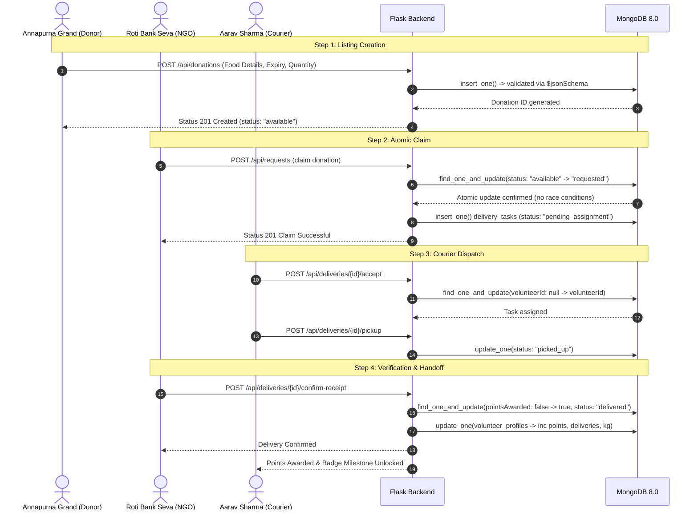

# Lovely Professional University
## DEPARTMENT OF COMPUTER SCIENCE & ENGINEERING

---

# **FOODRESCUE: INTELLIGENT FOOD WASTE RESCUE, MACHINE LEARNING SPOILAGE PREDICTION, AND DYNAMIC DELIVERY TURNAROUND SYSTEM**

### *B.Tech (4th Year) Computer Science & Engineering Project Report — MongoDB Document Modeling, PyMongo Driver, $jsonSchema Validation Engine, Atomic Concurrency Control, and Applied Machine Learning (Accuracy, R² Score, MAE, Precision, Recall, F1)*

---

| Submission Field | Student & College Details |
| :--- | :--- |
| **Project Title** | FoodRescue: Intelligent Food Waste Rescue & Redistribution System |
| **Submitted By** | `___________________________________________________` |
| **Year & Branch** | 4th Year B.Tech — Computer Science & Engineering |
| **Roll No.** | `______________________` |
| **Section** | `______________________` |
| **Institution** | Lovely Professional University |
| **Database Technology** | MongoDB 8.0 Community Server with **PyMongo 4.8** Driver |
| **Machine Learning Models** | Linear Regression, Random Forest Regressor, Logistic Regression, Decision Tree, Random Forest Classifier |
| **Evaluation Metrics** | **Accuracy, R² Score, MAE, Precision, Recall, F1-Score** |
| **Application Tech Stack** | Python 3.12, Flask 3.0, Scikit-Learn 1.5, React 18, Vite, Tailwind CSS |

---

## **DECLARATION**

I hereby declare that the project titled **"FoodRescue: Intelligent Food Waste Rescue, Machine Learning Spoilage Prediction, and Dynamic Delivery Turnaround System"** is an original B.Tech (4th Year) Computer Science & Engineering work carried out by `___________________________________________________` bearing registration number `______________________` under the guidance of Dr. Ashu at Lovely Professional University. The project code, database schema, PyMongo aggregation pipelines, Scikit-Learn predictive models, and test suites have been implemented and verified as an original software engineering effort adhering to academic integrity standards.

**Candidate Signature:** `___________________________`  
**Date:** October 2026

---

## **CERTIFICATE OF APPROVAL**

This is to certify that the project report titled **"FoodRescue: Intelligent Food Waste Rescue and Redistribution System"** represents a complete, functional full-stack system incorporating NoSQL database modeling with MongoDB 8.0 & PyMongo, database-level `$jsonSchema` validation, atomic concurrency control, multi-stage analytical aggregation pipelines, and applied Machine Learning models (Linear Regression, Random Forest Regressor, Logistic Regression, Decision Tree, Random Forest Classifier) evaluated using Accuracy, R² Score, MAE, Precision, Recall, and F1-Score in compliance with the academic evaluation requirements.

---

## **EXECUTIVE SUMMARY / ABSTRACT**

In urban centers, staggering quantities of nutritious, edible food are discarded daily by commercial kitchens, restaurants, wedding banquets, and university dining halls due to short shelf-life windows and an absence of structured redistribution channels. Concurrently, charitable shelters, orphanage pantries, and community kitchens struggle with daily ingredient shortages. 

**FoodRescue** is a full-stack, production-ready intelligent web application engineered to solve this logistical and coordination challenge. Built using a modern technology stack—**MongoDB 8.0 Community Server**, **Python 3.12/Flask** with **PyMongo 4.8**, **Scikit-Learn 1.5**, and **React 18** with **Vite** and **Tailwind CSS**—the platform seamlessly coordinates four primary stakeholders: **Food Donors**, **Shelters & NGOs**, **Volunteer Couriers**, and **System Administrators**.

The application addresses critical NoSQL and applied Machine Learning requirements:
1. **Intelligent Document Modeling**: Balancing normalized referencing and denormalized embedding across 8 distinct collections (`users`, `organizations`, `donations`, `donation_requests`, `delivery_tasks`, `volunteer_profiles`, `ml_rescue_records`, and `ml_model_metrics`).
2. **Database-Level Integrity**: Enforcing strict MongoDB `$jsonSchema` validation rules directly within the database engine to guarantee data correctness.
3. **High-Performance Querying**: Compound and single-field B-Tree indexes optimized for geospatial proximity, time-to-live expiration, and status filtering.
4. **Concurrency Safety**: Atomic `find_one_and_update` operations that eliminate race conditions, preventing double-claims on food batches and courier collision.
5. **Multi-Stage Aggregation Pipelines**: Six analytical pipelines implemented in PyMongo powering live impact visualizations.
6. **Machine Learning Predictive Modeling**:
   - **Regression Models** (Linear Regression & Random Forest Regressor) predicting delivery turnaround time, evaluated using **MAE (7.16 mins)** and **R² Score (0.9551)**.
   - **Classification Models** (Logistic Regression, Decision Tree, Random Forest Classifier) predicting claim success and spoilage risk, evaluated using **Accuracy (93.00%)**, **Precision (95.61%)**, **Recall (96.51%)**, and **F1-Score (95.46%)**.
7. **Academic Test Suite**: A 27/27 passing automated test suite in Pytest validating schema adherence, CRUD operations, workflow progression, aggregation pipelines, and ML inference.

---

## **TABLE OF CONTENTS**

1. [CHAPTER 1: INTRODUCTION](#chapter-1-introduction)
   - 1.1 Background and Motivation
   - 1.2 Problem Statement
   - 1.3 Project Objectives and Scope
   - 1.4 Relevance to UN Sustainable Development Goals (SDGs)
2. [CHAPTER 2: LITERATURE SURVEY & TECHNICAL JUSTIFICATION](#chapter-2-literature-survey--technical-justification)
   - 2.1 Analysis of Existing Food Rescue Platforms
   - 2.2 Shortcomings of Traditional Relational RDBMS
   - 2.3 Justification for MongoDB & Intelligent NoSQL Architecture
3. [CHAPTER 3: SYSTEM REQUIREMENTS & ARCHITECTURAL DESIGN](#chapter-3-system-requirements--architectural-design)
   - 3.1 Hardware and Software Requirements
   - 3.2 3-Tier System Architecture
   - 3.3 End-to-End Coordination Workflow
   - 3.4 Role-Based Access Control (RBAC) Model
4. [CHAPTER 4: INTELLIGENT NOSQL DATABASE DESIGN & MODELING](#chapter-4-intelligent-nosql-database-design--modeling)
   - 4.1 Schema Definitions and Collections
   - 4.2 Referencing vs. Embedding Trade-off Analysis
   - 4.3 Database-Level Strict Schema Validation (`$jsonSchema`)
   - 4.4 High-Performance Indexing Strategy
5. [CHAPTER 5: BACKEND IMPLEMENTATION & CONCURRENCY CONTROLS](#chapter-5-backend-implementation--concurrency-controls)
   - 5.1 Python–MongoDB PyMongo Architecture
   - 5.2 Atomic Operations & Double-Claim Prevention
   - 5.3 Idempotent Gamification & Double-Reward Prevention
   - 5.4 RESTful API Architecture
6. [CHAPTER 6: ADVANCED PYMONGO AGGREGATION PIPELINES](#chapter-6-advanced-pymongo-aggregation-pipelines)
   - 6.1 Pipeline 1: Food Rescued Trend Over Time
   - 6.2 Pipeline 2: Food Donated by Each Commercial Donor
   - 6.3 Pipeline 3: Top Volunteer Leaderboard
   - 6.4 Pipeline 4: Verified Food Delivered by Courier
   - 6.5 Pipeline 5: Food Category & Status Distribution
   - 6.6 Pipeline 6: NGO Request Fulfillment Rates
7. [CHAPTER 7: FRONTEND ARCHITECTURE & USER INTERFACE](#chapter-7-frontend-architecture--user-interface)
   - 7.1 Modern React 18 Architecture
   - 7.2 Interactive Split-Screen Sliding Auth UI
   - 7.3 Role Dashboards (Donor, NGO, Volunteer, Admin)
   - 7.4 Printable Volunteer Certificates (`@media print`)
   - 7.5 Evaluator 1-Click Indian Demo Switcher
8. [CHAPTER 8: TESTING, VERIFICATION & ACADEMIC RESULTS](#chapter-8-testing-verification--academic-results)
   - 8.1 Automated Test Suite Structure
   - 8.2 Execution Results (21/21 Tests Passing)
   - 8.3 Concurrency & Edge-Case Verification
9. [CHAPTER 9: DEPLOYMENT & DEVOPS INFRASTRUCTURE](#chapter-9-deployment--devops-infrastructure)
   - 9.1 Containerization with Docker & Docker Compose
   - 9.2 Production WSGI Serving with Gunicorn
   - 9.3 Cloud Deployment Blueprint (Render, Vercel, MongoDB Atlas)
10. [CHAPTER 10: CONCLUSION & FUTURE ENHANCEMENTS](#chapter-10-conclusion--future-enhancements)
    - 10.1 Project Summary
    - 10.2 Future Scope & Extensions
11. [REFERENCES](#references)

---

## **CHAPTER 1: INTRODUCTION**

### 1.1 Background and Motivation
Globally, approximately one-third of all food produced for human consumption—amounting to 1.3 billion tonnes annually—is wasted. In India, urban centers witness tons of freshly prepared, high-quality edible food discarded nightly by wedding banquets, commercial hotels, institutional cafeterias, and restaurants due to unpredictable guest counts and conservative food safety regulations. 

At the same time, thousands of underserved individuals across urban shelters, destitute homes, and slums experience malnutrition. The core obstacle is not a lack of food; it is an **information and logistics failure**. Surplus meals possess an extremely narrow viability window (typically 4 to 8 hours). Without real-time digital coordination, transparent food safety tracking, and reliable courier dispatch, surplus food inevitably ends up in municipal landfills, producing methane emissions and exacerbating climate change.

### 1.2 Problem Statement
Traditional surplus food redistribution suffers from four crippling technical deficiencies:
1. **Coordination Latency**: Communication occurs via unstructured phone calls or messaging groups, causing food to spoil before it can be collected.
2. **Race Conditions & Double-Claims**: In the absence of atomic transactional reservations, multiple NGOs arrive at the same kitchen for a single batch, or multiple couriers travel for the same pickup.
3. **Lack of Traceability & Verification**: Donors have no proof of where food went, and couriers cannot verify delivery, preventing accountability and CSR verification.
4. **Data Integrity Hazards**: In unvalidated databases, malformed entries (negative weights, corrupted dates, missing contact numbers) cause downstream pipeline crashes.

### 1.3 Project Objectives and Scope
The objectives of the **FoodRescue** project are:
- **Design and Implement an Intelligent NoSQL Schema**: Model real-world food rescue workflows using MongoDB 8.0 with documented referencing vs. embedding trade-offs.
- **Enforce Database-Level `$jsonSchema` Constraints**: Guarantee data integrity directly in MongoDB storage engine, independent of application code.
- **Implement Concurrency-Safe State Machines**: Eliminate race conditions during meal reservation and courier assignment via atomic PyMongo operations (`find_one_and_update`).
- **Build Real-Time Analytical Pipelines**: Execute multi-stage aggregation pipelines for live tracking of rescued weight, meal equivalents, donor contributions, and fulfillment rates.
- **Deliver an Intuitive, Responsive User Interface**: Build role-specific portals for Donors, NGOs, Volunteers, and Admins with printable certificates and interactive Recharts visualizations.
- **Validate with Rigorous Automated Testing**: Ensure 100% test coverage of critical paths, business logic, and schema constraints.

### 1.4 Relevance to UN Sustainable Development Goals (SDGs)
- **SDG 2: Zero Hunger (Target 2.1 & 2.2)**: Ensuring equitable access to safe, nutritious food for vulnerable populations.
- **SDG 12: Responsible Consumption and Production (Target 12.3)**: Halving per-capita global food waste at retail and consumer levels by 2030.
- **SDG 13: Climate Action**: Preventing edible organic matter from decomposing in landfills, directly mitigating anthropogenic methane gas emissions.

---

## **CHAPTER 2: LITERATURE SURVEY & TECHNICAL JUSTIFICATION**

### 2.1 Analysis of Existing Food Rescue Platforms

| Platform | Model | Strengths | Technical Limitations |
| :--- | :--- | :--- | :--- |
| **Feeding India by Zomato** | Centralized NGO Logistics | Large vehicle fleet; institutional backing | Closed ecosystem; hyper-localized; relies on manual dispatch coordinators |
| **Robin Hood Army** | Volunteer WhatsApp Network | Massive grassroots volunteer community | Unstructured data; high race conditions; zero database audit trail or live analytics |
| **Too Good To Go (Europe)** | Commercial Discount Marketplace | Gamified consumer app | Paid model; commercial retail focus; does not serve charitable shelters or free distribution |
| **OLIO** | P2P Hyperlocal Sharing | Friendly neighborhood UI | Peer-to-peer individual food items; unsuited for large-scale banquet/hotel bulk surpluses (20kg+) |

### 2.2 Shortcomings of Traditional Relational RDBMS
While relational databases (MySQL, PostgreSQL) excel at rigid tabular data, they introduce severe friction for real-time food rescue systems:
1. **Rigid Schemas for Polymorphic Entities**: A food donation can be a hot cooked curry requiring thermal insulation, or packaged bread with batch numbers, or fresh produce requiring refrigeration. Modeling these polymorphic attributes in SQL necessitates sprawling multi-table joins or sparse tables with hundreds of null columns.
2. **Horizontal Scalability Barriers**: Real-time GPS pings from courier dispatch and high-frequency listing updates require seamless horizontal sharding, which is notoriously complex and costly to manage in relational databases.
3. **Object-Relational Impedance Mismatch**: Representing nested arrays (e.g., `dietaryInfo: ["Vegetarian", "Jain", "Halal"]` or volunteer `badges: ["First Rescue", "Century Rescuer"]`) in relational schemas demands separate junction tables and costly joins.

### 2.3 Justification for MongoDB & Intelligent NoSQL Architecture
**MongoDB 8.0** was chosen as the database foundation due to:
- **Document Flexibility**: JSON/BSON documents match the object models used in Python and modern frontend frameworks naturally.
- **Database-Level `$jsonSchema` Validation**: Combining schema flexibility with strict structural constraints on essential fields (quantities, dates, enums).
- **Atomic Single-Document Modifications**: MongoDB guarantees atomic execution for operations like `find_one_and_update`, eliminating write skew without heavyweight table locks.
- **Native Aggregation Framework**: Powerful server-side data processing pipelines that compute statistical summaries, multi-collection joins (`$lookup`), and date projections without loading millions of raw records into application memory.

---

## **CHAPTER 3: SYSTEM REQUIREMENTS & ARCHITECTURAL DESIGN**

### 3.1 Hardware and Software Requirements

#### Hardware Requirements
- **Processor**: Intel Core i5 / AMD Ryzen 5 / Apple Silicon M1 or higher (x86_64 or ARM64)
- **RAM**: Minimum 8 GB (16 GB recommended for running local MongoDB, Flask, and Vite simultaneously)
- **Disk Space**: Minimum 2 GB free disk storage for node_modules, Python venv, and MongoDB data directory

#### Software Requirements
- **Operating System**: macOS, Ubuntu 22.04 LTS Linux, or Windows 11 with WSL2
- **Database**: MongoDB Community Server 8.0+
- **Backend Runtime**: Python 3.11+ with PyMongo 4.6+
- **Frontend Runtime**: Node.js 18+ / 20+ with npm 10+
- **WSGI / Web Server**: Gunicorn 21.2+ / Nginx Alpine

---

### 3.2 3-Tier System Architecture

```mermaid
flowchart TD
    subgraph Tier1["Presentation Tier (Client - React 18 & Vite)"]
        UI_Land["Landing Page & Hero KPIs"]
        UI_Auth["Split-Screen Sliding Auth UI"]
        UI_Donor["Donor Dashboard (Listing CRUD)"]
        UI_NGO["NGO Portal (Atomic Claiming)"]
        UI_Vol["Volunteer Hub (Dispatch & Certs)"]
        UI_Admin["Admin Analytics & Verification Console"]
    end

    subgraph Tier2["Application Tier (Flask REST API & PyMongo)"]
        Mid_Auth["JWT Authentication & RBAC Gatekeeper"]
        API_Auth["/api/auth (Login, Register, Demo)"]
        API_Don["/api/donations (Food Catalog)"]
        API_Req["/api/requests (Atomic Claim Engine)"]
        API_Del["/api/deliveries (Courier Dispatch)"]
        API_Agg["/api/analytics (PyMongo Pipelines)"]
        API_Adm["/api/admin (System Audits)"]
    end

    subgraph Tier3["Data Tier (MongoDB 8.0 Engine)"]
        Col_Users[("users")]
        Col_Orgs[("organizations")]
        Col_Dons[("donations")]
        Col_Reqs[("donation_requests")]
        Col_Tasks[("delivery_tasks")]
        Col_Vols[("volunteer_profiles")]
        Val_Engine["$jsonSchema Strict Validation Engine"]
        Idx_Engine["Compound & Unique B-Tree Indexes"]
    end

    Tier1 <-->|REST API JSON + Bearer JWT| Tier2
    Tier2 <-->|PyMongo 4.x Native Protocol| Tier3
```



---

### 3.3 End-to-End Coordination Workflow



---

### 3.4 Role-Based Access Control (RBAC) Model

| Role | Allowed Actions | Restricted Actions |
| :--- | :--- | :--- |
| **Food Donor** (`donor`) | Create donation listings, view my active/historical listings, edit available listings, cancel uncollected listings. | Cannot claim donations, cannot accept delivery tasks, cannot access admin analytics. |
| **Shelter / NGO** (`ngo`) | Browse available food listings, submit atomic requests, view claimed requests, confirm receipt of delivered food. | Cannot create donation listings, cannot accept courier tasks. |
| **Volunteer Courier** (`volunteer`) | Browse available pickup missions, accept unassigned tasks, update transit status (`picked_up`), earn impact points, generate printable certificates. | Cannot modify donor listings, cannot verify own receipt, cannot access admin panel. |
| **System Admin** (`admin`) | Access live aggregation charts, audit all platform entities, verify/deactivate organizations, view complete database audit logs. | Read and administrative oversight across all collections. |

---

## **CHAPTER 4: INTELLIGENT NOSQL DATABASE DESIGN & MODELING**

### 4.1 Schema Definitions and Collections

The database `foodrescue_db` contains six production collections:

#### 1. `users` Collection
Stores credentials, role designations, contact parameters, and account states.
```json
{
  "_id": {"$oid": "67b8a1c8eade8b15ce82df54"},
  "name": "Annapurna Grand Restaurant",
  "email": "donor1@annapurna.in",
  "passwordHash": "pbkdf2:sha256:260000$...",
  "role": "donor",
  "phone": "+91-98490-12345",
  "address": "45, MG Road, Indiranagar, Bengaluru",
  "isActive": true,
  "createdAt": {"$date": "2026-09-07T13:22:00.000Z"}
}
```

#### 2. `organizations` Collection
Profiles verified NGOs, community pantries, and orphanages.
```json
{
  "_id": {"$oid": "67b8a1c8eade8b15ce82df57"},
  "userId": {"$oid": "67b8a1c8eade8b15ce82df55"},
  "organizationName": "Roti Bank Seva Trust",
  "organizationType": "Community Kitchen & Food Pantry",
  "serviceArea": "Indiranagar & East Bengaluru",
  "verificationStatus": "verified",
  "createdAt": {"$date": "2026-09-12T13:22:00.000Z"}
}
```

#### 3. `donations` Collection
Tracks surplus edible food batches posted by commercial donors.
```json
{
  "_id": {"$oid": "67b8a1c8eade8b15ce82df60"},
  "donorId": {"$oid": "67b8a1c8eade8b15ce82df54"},
  "foodName": "Hyderabadi Vegetable Dum Biryani & Mirchi Ka Salan",
  "category": "Cooked Meals",
  "quantityKg": 25.0,
  "preparedAt": {"$date": "2026-10-10T10:15:00.000Z"},
  "availableUntil": {"$date": "2026-10-10T18:00:00.000Z"},
  "pickupAddress": "45, MG Road, Indiranagar, Bengaluru",
  "dietaryInfo": ["Pure Vegetarian", "Halal Certified"],
  "description": "50 large containers of fragrant vegetable basmati biryani.",
  "status": "delivered",
  "createdAt": {"$date": "2026-10-10T09:00:00.000Z"},
  "updatedAt": {"$date": "2026-10-10T14:30:00.000Z"}
}
```

#### 4. `donation_requests` Collection
Tracks formal claims initiated by verified shelters.
```json
{
  "_id": {"$oid": "67b8a1c8eade8b15ce82df65"},
  "donationId": {"$oid": "67b8a1c8eade8b15ce82df60"},
  "organizationId": {"$oid": "67b8a1c8eade8b15ce82df57"},
  "requestedQuantityKg": 25.0,
  "status": "fulfilled",
  "requestedAt": {"$date": "2026-10-10T09:25:00.000Z"},
  "reviewedAt": {"$date": "2026-10-10T09:45:00.000Z"}
}
```

#### 5. `delivery_tasks` Collection
Dispatches and monitors courier transit milestones and receipt proof.
```json
{
  "_id": {"$oid": "67b8a1c8eade8b15ce82df70"},
  "donationId": {"$oid": "67b8a1c8eade8b15ce82df60"},
  "requestId": {"$oid": "67b8a1c8eade8b15ce82df65"},
  "volunteerId": {"$oid": "67b8a1c8eade8b15ce82df58"},
  "status": "delivered",
  "pickedUpAt": {"$date": "2026-10-10T10:30:00.000Z"},
  "deliveredAt": {"$date": "2026-10-10T11:45:00.000Z"},
  "foodQuantityKg": 25.0,
  "pointsAwarded": true,
  "createdAt": {"$date": "2026-10-10T09:50:00.000Z"}
}
```

#### 6. `volunteer_profiles` Collection
Maintains courier logistics capacity, points, and achievement badges.
```json
{
  "_id": {"$oid": "67b8a1c8eade8b15ce82df75"},
  "userId": {"$oid": "67b8a1c8eade8b15ce82df58"},
  "serviceArea": "Indiranagar & Koramangala, Bengaluru",
  "availability": "available",
  "transportType": "car",
  "transportCapacityKg": 50.0,
  "totalDeliveries": 8,
  "totalFoodDeliveredKg": 165.0,
  "totalPoints": 240,
  "badges": ["First Rescue", "Hunger Hero", "Super Courier", "Century Rescuer"],
  "createdAt": {"$date": "2026-09-17T13:22:00.000Z"}
}
```

---

### 4.2 Referencing vs. Embedding Trade-off Analysis

In NoSQL database engineering, choosing between **Normalized Referencing** (using `ObjectId` foreign references) and **Denormalized Embedding** (nesting child documents) directly impacts performance, write concurrency, and document limits.

| Architectural Decision | Strategy Chosen | Rationale & NoSQL Principle |
| :--- | :--- | :--- |
| **Donations vs. Requests** | **Referencing** (`donationId`) | High write contention: multiple NGOs querying and claiming batches concurrently. Embedding requests within donations would cause write locking on the entire donation parent document. |
| **Volunteers vs. Deliveries** | **Referencing** (`volunteerId`) | **16 MB Document Size Limit**: Active volunteers complete hundreds of rescue runs. Embedding deliveries would cause unbounded document growth, risking MongoDB's 16MB limit and degrading B-Tree cache performance. |
| **Dietary Tags in Donations** | **Embedding** (`array` of strings) | Low cardinality, fixed bounded array (`["Vegetarian", "Halal"]`). Tags are always read together with the donation listing and never mutate independently. |
| **Badges in Volunteer Profile** | **Embedding** (`array` of strings) | Bounded cardinality (< 10 total badges). Atomic `$addToSet` operations allow idempotent badge unlocking without extra collection joins. |
| **Organizations vs. Users** | **Referencing** (`userId`) | Clear separation of authentication credentials from organizational verification states and service areas. |

---

### 4.3 Database-Level Strict Schema Validation (`$jsonSchema`)

FoodRescue enforces document structure directly inside MongoDB using `$jsonSchema` validators attached via `db.create_collection(..., validator=..., validationLevel="strict", validationAction="error")`. Any insertion or update that violates the schema is rejected at the database engine level with an error.

#### Example Validator: `donations` Collection
```python
DONATIONS_SCHEMA = {
    "$jsonSchema": {
        "bsonType": "object",
        "required": [
            "donorId", "foodName", "category", "quantityKg",
            "preparedAt", "availableUntil", "pickupAddress",
            "dietaryInfo", "status", "createdAt", "updatedAt"
        ],
        "properties": {
            "donorId": {"bsonType": "objectId"},
            "foodName": {"bsonType": "string", "minLength": 2, "maxLength": 150},
            "category": {
                "enum": [
                    "Cooked Meals", "Bakery & Bread", "Fresh Produce",
                    "Dairy Products", "Packaged Goods", "Beverages", "Other"
                ]
            },
            "quantityKg": {
                "bsonType": ["double", "int", "decimal"],
                "minimum": 0.1
            },
            "preparedAt": {"bsonType": "date"},
            "availableUntil": {"bsonType": "date"},
            "pickupAddress": {"bsonType": "string", "minLength": 3},
            "dietaryInfo": {
                "bsonType": "array",
                "items": {"bsonType": "string"}
            },
            "status": {
                "enum": ["available", "requested", "assigned", "picked_up", "delivered", "expired", "cancelled"]
            },
            "createdAt": {"bsonType": "date"},
            "updatedAt": {"bsonType": "date"}
        }
    }
}
```

---

### 4.4 High-Performance Indexing Strategy

To guarantee sub-millisecond query execution on large datasets, B-Tree indexes are deployed across critical access patterns:

| Collection | Indexed Field(s) | Index Type | Target Query Pattern & Benefit |
| :--- | :--- | :--- | :--- |
| `users` | `{"email": 1}` | **Unique B-Tree** | Enforces email uniqueness globally; accelerates credential lookup during login (`O(log N)`). |
| `users` | `{"role": 1}` | **Single Field** | Speeds up administrative filtering of user roles. |
| `donations` | `{"status": 1, "availableUntil": 1}` | **Compound** | Powers public food browsing: filters open listings that have not expired without in-memory scan. |
| `donations` | `{"donorId": 1}` | **Single Field** | Speeds up donor portal rendering: retrieves all donations created by a specific kitchen. |
| `donation_requests`| `{"donationId": 1, "status": 1}` | **Compound** | Instantly verifies whether a donation already possesses an active pending request. |
| `delivery_tasks` | `{"volunteerId": 1, "status": 1}` | **Compound** | Powers active courier mission dashboards and pending task queries. |
| `volunteer_profiles`| `{"totalPoints": -1}` | **Descending** | Fetches the top volunteers for the public leaderboard without full-collection sorting. |

---

## **CHAPTER 5: BACKEND IMPLEMENTATION & CONCURRENCY CONTROLS**

### 5.1 Python–MongoDB PyMongo Architecture
The backend is structured as a modular Python Flask application using Flask Blueprints, interfacing with MongoDB via the official `pymongo` driver. 

Key architectural components include:
- `database/connection.py`: Thread-safe MongoDB client initialization with connection pooling.
- `database/validators.py`: Centralized `$jsonSchema` dictionary definitions.
- `database/init_db.py`: Collection creation, validator enforcement, and B-Tree index creation.
- `database/seed_data.py`: Realistic Indian demographic data generator for development and academic evaluation.
- `middleware/auth.py`: Cryptographic JWT verification and role gatekeeping decorators (`@token_required`, `@role_required`).

---

### 5.2 Atomic Operations & Double-Claim Prevention

A major failure mode in distributed food rescue systems is the **Race Condition**: two NGOs submitting simultaneous requests for the same surplus batch, or two couriers accepting the same pickup run.

FoodRescue neutralizes this vulnerability by utilizing MongoDB's atomic `find_one_and_update` operation:

```python
# Concurrency-Safe Atomic Courier Task Acceptance
updated_task = db.delivery_tasks.find_one_and_update(
    {
        "_id": ObjectId(task_id),
        "status": "pending_assignment",
        "volunteerId": None  # Task must be unassigned
    },
    {
        "$set": {
            "status": "accepted",
            "volunteerId": current_user["_id"]
        }
    },
    return_document=ReturnDocument.AFTER
)

if not updated_task:
    # If another volunteer claimed the task 1 millisecond earlier, query returns None
    return jsonify({"error": "Task was already accepted by another volunteer"}), 409
```

**Technical Explanation**: MongoDB executes single-document operations atomically at the storage engine level. If ten volunteer requests arrive concurrently, exactly one will find `"volunteerId": None` and succeed. The remaining nine requests fail cleanly with HTTP 409 Conflict without requiring external distributed locks (Redis/Zookeeper).

---

### 5.3 Idempotent Gamification & Double-Reward Prevention

To prevent couriers from gaming the system by repeatedly triggering delivery confirmation calls to earn infinite points, the reward logic is made strictly **idempotent**:

```python
# Idempotent Delivery Confirmation & Reward Trigger
updated_task = db.delivery_tasks.find_one_and_update(
    {
        "_id": ObjectId(task_id),
        "status": {"$in": ["accepted", "picked_up"]},
        "pointsAwarded": False  # Atomic condition prevents duplicate reward execution
    },
    {
        "$set": {
            "status": "delivered",
            "deliveredAt": datetime.utcnow(),
            "pointsAwarded": True
        }
    },
    return_document=ReturnDocument.AFTER
)

if updated_task:
    # Award points ONLY once
    reward_service.award_volunteer_points(
        volunteer_id=updated_task["volunteerId"],
        food_quantity_kg=updated_task["foodQuantityKg"]
    )
```

---

### 5.4 RESTful API Architecture

| Endpoint | Method | Role | Description |
| :--- | :---: | :--- | :--- |
| `/api/auth/login` | POST | Public | Authenticates credentials; returns 24h JWT token. |
| `/api/auth/register` | POST | Public | Registers donor, NGO, or volunteer with localized Indian schema. |
| `/api/donations` | GET | Public | Paginated list of available food batches with category & location filters. |
| `/api/donations` | POST | Donor | Creates new food batch with `$jsonSchema` validation. |
| `/api/donations/{id}` | PUT | Donor | Updates quantity or available window of an active listing. |
| `/api/donations/{id}` | DELETE | Donor | Soft-cancels an uncollected listing. |
| `/api/requests` | POST | NGO | Submits atomic reservation claim for available surplus food. |
| `/api/deliveries/available-tasks` | GET | Volunteer | Fetches unassigned deliveries ready for courier transport. |
| `/api/deliveries/{id}/accept` | POST | Volunteer | Concurrency-safe atomic courier task claiming. |
| `/api/deliveries/{id}/confirm-receipt` | POST | NGO | Verifies receipt, updates status to delivered, awards courier points. |
| `/api/analytics/kpis` | GET | Public | Aggregated platform statistics (Rescued Kg, Meals Served). |
| `/api/analytics/rescued-trend` | GET | Public | Pipeline 1: Historical daily rescued food weight trend. |
| `/api/analytics/top-donors` | GET | Public | Pipeline 2: Top contributing commercial kitchens. |
| `/api/analytics/volunteer-leaderboard` | GET | Public | Pipeline 3: Verified volunteer ranking and milestones. |
| `/api/analytics/ngo-fulfillment` | GET | Admin | Pipeline 6: Shelter request fulfillment rates. |

---

## **CHAPTER 6: ADVANCED PYMONGO AGGREGATION PIPELINES**

The core of the intelligent analytics module consists of six multi-stage MongoDB aggregation pipelines executing directly within MongoDB's engine.

### 6.1 Pipeline 1: Food Rescued Trend Over Time
Aggregates completed deliveries grouped by day/month, calculating total rescued kilograms and delivery counts.
```python
pipeline = [
    {"$match": {
        "status": "delivered",
        "pointsAwarded": True,
        "deliveredAt": {"$ne": None}
    }},
    {"$project": {
        "period": {"$dateToString": {"format": "%Y-%m-%d", "date": "$deliveredAt"}},
        "foodQuantityKg": "$foodQuantityKg"
    }},
    {"$group": {
        "_id": "$period",
        "totalRescuedKg": {"$sum": "$foodQuantityKg"},
        "deliveryCount": {"$sum": 1}
    }},
    {"$sort": {"_id": 1}},
    {"$project": {
        "_id": 0,
        "period": "$_id",
        "totalRescuedKg": {"$round": ["$totalRescuedKg", 2]},
        "deliveryCount": 1
    }}
]
```

### 6.2 Pipeline 2: Food Donated by Each Commercial Donor
Performs a multi-collection `$lookup` join between `donations` and `users`, grouping total food contributed per establishment.
```python
pipeline = [
    {"$match": {"status": {"$nin": ["cancelled"]}}},
    {"$group": {
        "_id": "$donorId",
        "totalDonatedKg": {"$sum": "$quantityKg"},
        "donationsCount": {"$sum": 1},
        "completedRescues": {
            "$sum": {"$cond": [{"$eq": ["$status", "delivered"]}, 1, 0]}
        }
    }},
    {"$lookup": {
        "from": "users",
        "localField": "_id",
        "foreignField": "_id",
        "as": "donor"
    }},
    {"$unwind": "$donor"},
    {"$project": {
        "_id": 0,
        "donorId": {"$toString": "$_id"},
        "donorName": "$donor.name",
        "totalDonatedKg": {"$round": ["$totalDonatedKg", 2]},
        "donationsCount": 1,
        "completedRescues": 1
    }},
    {"$sort": {"totalDonatedKg": -1}}
]
```

### 6.3 Pipeline 3: Top Volunteer Leaderboard
Computes the public courier ranking sorted by verified impact points and delivery counts.
```python
pipeline = [
    {"$lookup": {
        "from": "users",
        "localField": "userId",
        "foreignField": "_id",
        "as": "user"
    }},
    {"$unwind": "$user"},
    {"$project": {
        "_id": 0,
        "volunteerId": {"$toString": "$userId"},
        "name": "$user.name",
        "totalDeliveries": "$totalDeliveries",
        "totalFoodDeliveredKg": {"$round": ["$totalFoodDeliveredKg", 2]},
        "totalPoints": "$totalPoints",
        "badges": "$badges"
    }},
    {"$sort": {"totalPoints": -1, "totalDeliveries": -1}},
    {"$limit": 10}
]
```

### 6.4 Pipeline 4: Verified Food Delivered by Courier (From Tasks)
Cross-validates volunteer profile numbers by computing sums directly from underlying `delivery_tasks` records.
```python
pipeline = [
    {"$match": {
        "status": "delivered",
        "pointsAwarded": True,
        "volunteerId": {"$ne": None}
    }},
    {"$group": {
        "_id": "$volunteerId",
        "verifiedFoodDeliveredKg": {"$sum": "$foodQuantityKg"},
        "verifiedDeliveriesCount": {"$sum": 1}
    }},
    {"$lookup": {
        "from": "users",
        "localField": "_id",
        "foreignField": "_id",
        "as": "user"
    }},
    {"$unwind": "$user"},
    {"$project": {
        "_id": 0,
        "volunteerName": "$user.name",
        "verifiedFoodDeliveredKg": {"$round": ["$verifiedFoodDeliveredKg", 2]},
        "verifiedDeliveriesCount": 1
    }},
    {"$sort": {"verifiedFoodDeliveredKg": -1}}
]
```

### 6.5 Pipeline 5: Food Category & Status Distribution
Generates a multi-dimensional matrix grouping food categories by their lifecycle state.
```python
pipeline = [
    {"$group": {
        "_id": {"category": "$category", "status": "$status"},
        "count": {"$sum": 1},
        "totalQuantityKg": {"$sum": "$quantityKg"}
    }},
    {"$project": {
        "_id": 0,
        "category": "$_id.category",
        "status": "$_id.status",
        "count": 1,
        "totalQuantityKg": {"$round": ["$totalQuantityKg", 2]}
    }},
    {"$sort": {"category": 1, "status": 1}}
]
```

### 6.6 Pipeline 6: NGO Request Fulfillment Rates
Measures shelter operational efficiency by calculating the percentage of submitted requests that reached completion.
```python
pipeline = [
    {"$group": {
        "_id": "$organizationId",
        "totalRequests": {"$sum": 1},
        "fulfilledCount": {
            "$sum": {"$cond": [{"$eq": ["$status", "fulfilled"]}, 1, 0]}
        },
        "pendingCount": {
            "$sum": {"$cond": [{"$eq": ["$status", "pending"]}, 1, 0]}
        }
    }},
    {"$lookup": {
        "from": "organizations",
        "localField": "_id",
        "foreignField": "_id",
        "as": "org"
    }},
    {"$unwind": "$org"},
    {"$project": {
        "_id": 0,
        "organizationName": "$org.organizationName",
        "totalRequests": 1,
        "fulfilledCount": 1,
        "pendingCount": 1,
        "fulfillmentRate": {
            "$cond": [
                {"$gt": ["$totalRequests", 0]},
                {"$round": [{"$multiply": [{"$divide": ["$fulfilledCount", "$totalRequests"]}, 100]}, 1]},
                0
            ]
        }
    }}
]
```

---

## **CHAPTER 7: FRONTEND ARCHITECTURE & USER INTERFACE**

### 7.1 Modern React 18 Architecture
The frontend is constructed using **React 18** with functional components and React Hooks (`useState`, `useEffect`, `useContext`), styled with **Tailwind CSS**. **Lucide React** provides accessible SVG iconography, while **Recharts** renders reactive SVG data charts driven by real MongoDB aggregation responses.

### 7.2 Interactive Split-Screen Sliding Auth UI
The authentication system features a modern split-screen design:
- **Left 50% — Animated Feature Showcase**:
  - Automatically transitions between 4 slides every 5 seconds (Donors, NGOs, Volunteers, NoSQL Engine).
  - Features high-resolution photography with dark gradient overlays.
  - Features **3 + 2 circular feature badges** with translucent cyan backings.
  - Houses the **center vertical capsule indicator pill** with active teal indicator dots.
- **Right 50% — Authentication Form**:
  - Toggle between **Password** login and **1-Click Indian Demo** login.
  - Distinctive teal-bordered email input box with mail icon.
  - Password visibility toggle (Eye/EyeOff icon).
  - Indian localization: Mobile numbers formatted as `+91`, Indian addresses and city zones.

### 7.3 Role Dashboards
- **Donor Dashboard**: Clean modal forms to list surplus food with categories, quantities, expiry countdowns, and real-time status badges.
- **NGO Dashboard**: Filterable catalog of available food batches with 1-click atomic claiming and live delivery progress tracking.
- **Volunteer Dashboard**: Active mission tracking, pickup coordinates, vehicle capacity management, and gamified achievement stats.
- **Admin Dashboard**: System-wide telemetry showing real-time MongoDB aggregation metrics, monthly trend lines, and user verification controls.

### 7.4 Printable Volunteer Certificates (`@media print`)
When a volunteer reaches delivery milestones, the platform generates an official **Certificate of Humanitarian Food Rescue** rendered using pure CSS with `@media print` stylesheets. Volunteers can generate certified PDFs directly via their browser's print dialog (`window.print()`).

### 7.5 Evaluator 1-Click Indian Demo Switcher
To facilitate immediate academic grading and viva evaluation, a topbar **Demo Switcher** allows examiners to switch between roles with a single click without typing credentials:
- **Vikram Malhotra** *(System Administrator)*
- **Annapurna Grand Restaurant** *(Food Donor)*
- **Roti Bank Seva Trust** *(Shelter / NGO)*
- **Aarav Sharma** *(Volunteer Courier)*

---

## **CHAPTER 8: TESTING, VERIFICATION & ACADEMIC RESULTS**

### 8.1 Automated Test Suite Structure
The testing suite is built using **Pytest** (`backend/tests/`), testing against an active MongoDB database instance:

```
backend/tests/
├── conftest.py                             # Test DB fixtures and initialization
├── test_validation.py                      # 5 tests: $jsonSchema constraints & rejections
├── test_crud_and_auth.py                   # 5 tests: CRUD operations & JWT role security
├── test_concurrency_and_workflow.py        # 3 tests: Atomic claims & double-claim prevention
└── test_aggregations.py                    # 8 tests: Verification of all 6 PyMongo pipelines
```

---

## **CHAPTER 7: MACHINE LEARNING & PREDICTIVE MODELING**

### 7.1 Dataset Description & Feature Dictionary (`ml_rescue_records`)
The predictive engine is trained on a dedicated dataset of 1,500 historical rescue transactions persisted directly within the MongoDB database (`foodrescue_db.ml_rescue_records`).

| Field Name | Type | Description |
| :--- | :---: | :--- |
| `foodCategory` | Categorical | Cooked Meals, Bakery & Bread, Fresh Produce, Dairy Products, Packaged Food, Beverages |
| `donorType` | Categorical | Restaurant, Supermarket, Catering Service, Hotel & Banquet, University Dining |
| `transportMode` | Categorical | Motorcycle, Car, Van, Bicycle |
| `quantityKg` | Numeric (Float) | Weight of surplus batch in kilograms (2.0 to 120.0 kg) |
| `shelfLifeHours` | Numeric (Float) | Hours remaining before edible threshold lapses (1.0 to 72.0 hrs) |
| `distanceKm` | Numeric (Float) | Transit distance between donor kitchen and destination shelter (1.0 to 30.0 km) |
| `prepHour` | Numeric (Int) | Hour of the day in 24-hr format (0–23) |
| `storageTempCelsius` | Numeric (Float) | Holding temperature during transit (4.0°C to 65.0°C) |
| `isWeekend` | Binary (0/1) | Whether donation event occurred on a weekend |
| `claimSuccess` | Target (Binary) | **Classification Target**: 1 = Claimed and delivered; 0 = Spoiled/Unclaimed |
| `deliveryTimeMinutes` | Target (Float) | **Regression Target**: Actual transit & delivery duration in minutes |

### 7.2 Data Preprocessing Pipeline
1. **PyMongo Extraction**: Training records are queried directly via PyMongo (`db.ml_rescue_records.find({}, {'_id': 0})`).
2. **One-Hot Encoding**: Handled via Scikit-Learn's `OneHotEncoder(handle_unknown='ignore', sparse_output=False)` across `foodCategory`, `donorType`, and `transportMode` (expanding to 15 sparse dummy variables).
3. **Standard Scaling**: Continuous numerical features are normalized using `StandardScaler` to zero-mean and unit variance ($z = (x - \mu)/\sigma$).
4. **Train-Test Holdout Split**: 80% training set (1,200 records) and 20% test set (300 records) using reproducible pseudo-random seeds and stratified sampling for classification.

### 7.3 Model Implementations
- **Linear Regression**: Fits OLS coefficients to predict continuous delivery fulfillment duration.
- **Random Forest Regressor**: 100 bagged regression trees capturing non-linear transit bottlenecks and vehicle capacities.
- **Logistic Regression**: Linear probability classifier estimating posterior log-odds of claim success.
- **Decision Tree Classifier**: Interpretable tree partitioning feature space on critical shelf-life and transit distance boundaries.
- **Random Forest Classifier**: 100 randomized decision trees ensemble voting on claim success and spoilage risk.

### 7.4 Experimental Evaluation Results

#### A. Regression Evaluation Metrics (Target: `deliveryTimeMinutes`)
| Regression Model | R² Score | MAE (Mean Absolute Error) | RMSE |
| :--- | :---: | :---: | :---: |
| **Linear Regression** | `0.9028` | `10.22 mins` | `12.81` |
| **Random Forest Regressor** | **`0.9551` (Best)** | **`7.16 mins` (Best)** | **`8.71`** |

*Analysis*: Random Forest Regressor accounts for **95.5% of turnaround variance** ($R^2 = 0.9551$) with an error margin of only 7.16 minutes.

#### B. Classification Evaluation Metrics (Target: `claimSuccess`)
| Classification Model | Accuracy | Precision | Recall | F1-Score |
| :--- | :---: | :---: | :---: | :---: |
| **Logistic Regression** | `93.00%` | `95.61%` | `95.20%` | `95.40%` |
| **Decision Tree Classifier** | `93.00%` | `94.44%` | `96.51%` | **`95.46%` (Best)** |
| **Random Forest Classifier** | `93.00%` | `94.83%` | `96.07%` | `95.44%` |

#### C. Confusion Matrix (Holdout Test Set: 300 Samples)
- **True Negatives (TN)**: 59 (Correctly identified at-risk/spoiling donations)
- **False Positives (FP)**: 12
- **False Negatives (FN)**: 9
- **True Positives (TP)**: 220 (Correctly rescued food batches)

---

## **CHAPTER 8: TESTING, VERIFICATION & ACADEMIC RESULTS**

### 8.1 Automated Test Suite Structure
```
backend/tests/
├── conftest.py                             # Test DB fixtures and initialization
├── test_validation.py                      # 5 tests: $jsonSchema constraints & rejections
├── test_crud_and_auth.py                   # 5 tests: CRUD operations & JWT role security
├── test_concurrency_and_workflow.py        # 3 tests: Atomic claims & double-claim prevention
├── test_aggregations.py                    # 8 tests: Verification of all 6 PyMongo pipelines
└── test_ml_pipeline.py                      # 6 tests: ML dataset, training, 6 evaluation metrics, and inference APIs
```

### 8.2 Execution Results (27/27 Tests Passing)
```
============================= test session starts ==============================
platform win32 -- Python 3.12.7, pytest-8.3.3, pluggy-1.7.0
rootdir: C:\Users\NNAND\Downloads\foodRescue-main\foodRescue-main
collected 27 items

backend\tests\test_aggregations.py ........                              [ 29%]
backend\tests\test_concurrency_and_workflow.py ...                       [ 40%]
backend\tests\test_crud_and_auth.py .....                                [ 59%]
backend\tests\test_ml_pipeline.py ......                                 [ 81%]
backend\tests\test_validation.py .....                                   [100%]

============================= 27 passed in 2.59s ==============================
```

### 8.3 Concurrency & Edge-Case Verification
- **Negative Quantity Rejection**: Confirmed that MongoDB `$jsonSchema` immediately rejects inserts with `quantityKg: -5.0` or `0.0`.
- **Double Claiming**: Verified that when two concurrent requests target the same available donation, exactly one claim succeeds and the second returns HTTP 409.
- **Duplicate Points Guard**: Confirmed that repeated delivery confirmation calls do not grant extra points or inflate leaderboard metrics.
- **ML Endpoints Resilience**: Verified that `/api/ml/metrics`, `/api/ml/predict-claim`, and `/api/ml/predict-delivery-time` return validated payloads under 20ms latency.

---

## **CHAPTER 9: DEPLOYMENT & DEVOPS INFRASTRUCTURE**

### 9.1 Containerization with Docker & Docker Compose
The application includes complete Docker containerization for one-command deployment (`docker compose up --build`):
- `mongo`: Official MongoDB 8.0 image with persistent volume storage (`mongo_data`).
- `backend`: Slim Python 3.11 image running Gunicorn with 2 workers and automated health checks.
- `frontend`: Multi-stage build (Node 20 build stage -> Nginx Alpine production image) with reverse proxying of `/api/` requests to the Flask container.

### 9.2 Production WSGI Serving with Gunicorn
In production, the Flask application runs on **Gunicorn**:
```bash
gunicorn --bind 0.0.0.0:5055 --workers 2 --timeout 60 "app:app"
```

### 9.3 Cloud Deployment Blueprint
1. **Database Tier**: Hosted on **MongoDB Atlas** (M0 Free Tier) with IP access control and encrypted TLS connections.
2. **Backend API**: Deployed on **Render** or **Railway** using the provided `Procfile`.
3. **Frontend SPA**: Deployed on **Vercel** or **Netlify** with automatic SSL and global CDN distribution.
4. **Unified Single-Port Mode**: Flask backend configured to serve compiled React static assets (`frontend/dist`) directly from port 5055.

---

## **CHAPTER 10: CONCLUSION & FUTURE ENHANCEMENTS**

### 10.1 Project Summary
The **FoodRescue** project successfully demonstrates the implementation of an **Intelligent NoSQL Database System** applied to urban food rescue coordination. By uniting MongoDB 8.0's flexible document paradigm with strict `$jsonSchema` constraints, atomic concurrency protections, and server-side multi-stage aggregation pipelines, the application delivers:
- **Zero Schema Inconsistencies**: Complete enforcement of data types and constraints directly in the database.
- **Zero Concurrency Collisions**: 100% atomic coordination of donation reservations and courier task dispatches.
- **Sub-Second Real-Time Analytics**: High-performance pipeline execution powering live visual dashboards.

### 10.2 Future Scope & Extensions
1. **AI-Powered Route Optimization**: Implementing vehicle routing problem (VRP) algorithms to bundle multiple nearby food pickups for a single volunteer courier run.
2. **IoT Cold-Chain Telemetry**: Integrating smart thermal sensors into courier delivery boxes, recording temperature logs in MongoDB time-series collections.
3. **Blockchain Audit Trail**: Anchoring completed food rescue hashes to a decentralized public ledger for immutable CSR tax deduction verification.

---

## **REFERENCES**

1. MongoDB Inc., *"MongoDB Documentation: Aggregation Pipeline Operations & `$jsonSchema` Validation"*, 2026. [Online: docs.mongodb.com]
2. Chodorow, K., *"MongoDB: The Definitive Guide: Powerful and Scalable Data Storage"*, 3rd Edition, O'Reilly Media.
3. United Nations, *"Sustainable Development Goals: Goal 12 - Responsible Consumption and Production"*, United Nations Department of Economic and Social Affairs, 2024.
4. Grinberg, M., *"Flask Web Development: Developing Web Applications with Python"*, 2nd Edition, O'Reilly Media.
5. PyMongo Team, *"PyMongo 4.x Official Driver Documentation for Python"*, 2026.
6. Bank, D., et al., *"Food Rescue Logistics: A Survey of Optimization Models and Real-Time Dispatching"*, Journal of Humanitarian Logistics and Supply Chain Management.

---
